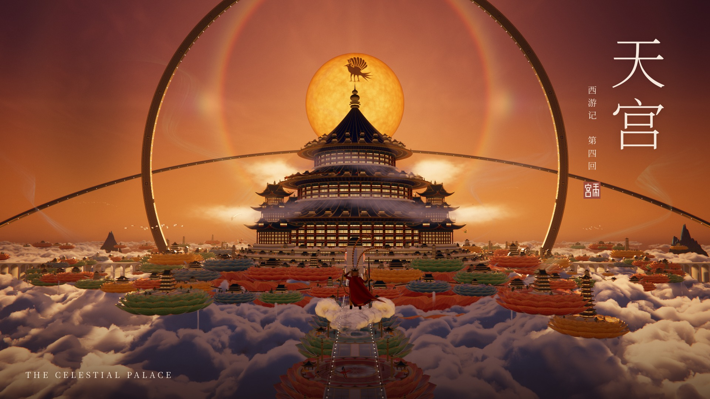

# 天宫 · The Celestial Palace

**在线看片、入宫漫游：<https://dososo.github.io/tiangong/>**　·　直接入宫：[漫游页](https://dososo.github.io/tiangong/roam/)　·　下载：[4K](https://github.com/dososo/tiangong/releases/download/v1.0.0/tiangong_4k.mp4) / [1080p](https://github.com/dososo/tiangong/releases/download/v1.0.0/tiangong_1080p.mp4) / [配乐](https://github.com/dososo/tiangong/releases/download/v1.0.0/tiangong_score.m4a) / [21 张 4K 静帧](https://github.com/dososo/tiangong/releases/download/v1.0.0/tiangong_stills_4k.zip)

[](https://dososo.github.io/tiangong/)

《西游记》第四回，孙悟空第一次上天。这里是他看见的那座天宫：一部 168 秒的影片，和一座可以走进去的天宫。两样东西出自同一套代码。

- 影片 168 秒，3840×2160，每秒 24 帧，共 4032 帧，每一帧都由着色器算出来
- 漫游页是一个 2.5 MB 的 HTML 文件，离线可用；十五处观景，可以乘鹤、骑龙、驾筋斗云
- 原生 WebGL2，没有三维引擎；画面不用任何模型、贴图或图片文件，也没有用生成式图像或视频模型
- 屏上十三句字幕全部是《西游记》第四回原文，逐字核对过
- 配乐「金声玉振」：以钟开篇，以磬收尾；穿过三十三重天时，三十三声钟一重一声

## 怎么看

**看片**：打开[首页](https://dososo.github.io/tiangong/)，戴耳机，关灯。首页放的是 1080p 网页版；要最好的画质，下载 [4K 版](https://github.com/dososo/tiangong/releases/download/v1.0.0/tiangong_4k.mp4)（847 MB，HEVC 10 位）。

**入宫**：打开[漫游页](https://dososo.github.io/tiangong/roam/)，点「入」。需要支持 WebGL2 的浏览器，在桌面 Chrome 和 Safari 内核上验证过。

| 操作 | 效果 |
|---|---|
| 拖动 | 环顾 |
| 滚轮、双指 | 进退 |
| 双击 | 飞往所指之处 |
| `W` `A` `S` `D`、方向键 | 前后左右 |
| 空格、`Q` | 升、降；按住 `Shift` 疾行 |
| `[` `]` | 上一处、下一处 |
| `,` `.` | 时辰进退；点日晷正中，时光流转 |
| `M` | 召行者，驾筋斗云 |
| `T` | 巡游 |
| `F` | 定格：逐帧累积成一张静帧，`S` 存图 |
| `H` `N` `/` `Esc` | 隐去界面、开关声音、打开帮助、退出骑乘或巡游 |
| 触屏 | 单指环顾，双指开合进退，双指拖移升降左右，双击前往 |

## 本地运行

```bash
git clone https://github.com/dososo/tiangong.git
```

```bash
cd tiangong && node tools/site_serve.mjs . 8791
```

然后打开 `http://localhost:8791/tiangong/`。没有依赖，没有构建步骤。用 `python3 -m http.server 8791` 也能打开，但它不支持分段请求，视频没法拖进度，Safari 里放不出来。

只想走一走的话，直接双击 `roam/index.html` 就行。

## 四种画

影片把四种中国画接成一条路，从水墨走到曼荼罗，最后收进一只眼睛。

| 段 | 时间 | 画法 | 看见什么 |
|---|---|---|---|
| 一 | 00:00–00:16 | 水墨 | 月夜云海，浑天仪的环圈住月亮，一个金点飞进来 |
| 二 | 00:16–01:28 | 青绿与金碧 | 龙柱、南天门；门开，金光灌满画面；三十三座天宫 |
| 三 | 01:28–02:00 | 夜空与暮色 | 太阳从天宫底下飞过，月亮贴着坛边过；万圣朝王 |
| 四 | 02:00–02:33 | 藻井与曼荼罗 | 穿过三十三重天：抬头是藻井，低头是曼荼罗，再往后是一只金睛 |
| 合 | 02:33–02:48 | 一个点 | 天宫还在，行者只是画里一个小小的背影 |

全片没有人脸特写，没有台词，玉帝始终没有现身，只有光。逐镜的分镜、原文和声音设计见 [docs/STORYBOARD.md](docs/STORYBOARD.md)。

## 实现要点

**一帧是怎么来的**（`src/core/engine.js`）。每帧渲染 24 到 72 张子帧再平均。每张子帧挪一点时间、一点镜头、一点像素位置、太阳盘面上换一个点，运动模糊、景深、抗锯齿、日影的软边就都出自同一次累积。M4 Pro 上渲完 4K 全片用了 5.8 小时。

**渲染器**（`src/core/`）。延迟着色，几何缓冲一趟写完，材质由每个顶点自带的编号决定（`gbuffer.js`）。天空是解析式的：22° 日晕、幻日、银河，北斗按真实比例（`glsl.js`）。云海用光线步进（`passes.js`）。彩画、藻井、门扇格心、匾额这些纹样用 Canvas2D 现画（`ornament.js`）。

**建筑**（`src/arch/`、`src/world/`）。瓦垄、斗拱、鸱吻、台基、栏杆先写成一套营造语汇（`parts.js`），再搭成殿、阁、楼、门（`buildings.js`、`heaven.js`）。原文说「三十三座天宫」「七十二重宝殿」，场景里就是 33 座宫、72 座殿；南天门宽 430 米，门洞 84×130 米（`world.js`）。

**生灵**（`src/life/`）。龙、飞天、百官、行者先写成有向距离场，再用 surface nets 提成网格（`sdf.js`、`dragon.js`、`people.js`）；飞着的龙，龙身在顶点着色器里沿曲线弯。

**分镜**（`src/film/`）。画面是时间的纯函数，随机数用固定种子，不读系统时钟。没有改动的镜头隔几个小时再渲一遍，解码后的 MD5 一样（验证报告 V12）。

**漫游**（`src/explore/`）。同一套场景和着色器，每帧只渲一张子帧，靠时间累积补细节，按显卡余量自动调内部分辨率（`rt.js`）。按 `F` 定格，走回影片那条渲染路径。

**配乐**（`audio/`）。编钟、磬、鼓、箫、笙、混响和合唱的主层由程序合成（`dsp.py`），其余乐器和合唱的底层用开放授权的采样演奏（`sf.py`），乐谱、对位和母带都在代码里（`score.py`、`mix.py`）。音阶用宫调式，四度升高，取雅乐的「变徵」。

## 重新渲染

需要 macOS、Google Chrome、node 22、Playwright 1.58、ffmpeg 8、bun 1.3、Python 3.10（numpy、Pillow、fonttools）。

4K 全片，可以随时中断，再跑会接着渲：

```bash
node build_film/tools/render.mjs --w 3840 --h 2160 --spp 24 --dir "$PWD/out/film4k"
```

抽静帧：

```bash
python3 tools/stills.py
```

编码成片（需要先有配乐母带，见下）：

```bash
node tools/encode.mjs --cover delivery/stills/21_J_天宫.jpg
```

打包漫游页：

```bash
node tools/build_explore.mjs delivery/tiangong_explore.html
```

重做配乐另需 scipy、soundfile、numba 和 FluidSynth。把 [soundfonts-v1](https://github.com/dososo/blcaptain-code-band/releases/tag/soundfonts-v1) 里的音色文件放进 `samples/`，再运行：

```bash
cd audio && python3 score.py && python3 mix.py
```

`build_film/` 是成片所用源码的冻结快照，`src/` 是现行版。抽 18 帧对照，逐字节相同（验证报告 V13）。

发布前从一份全新拷贝试过：漫游页重新打包，和 `roam/index.html` 一个字节不差；4K 重渲第 1152 到 1247 帧，解码后的 MD5 和成片母版的 96 帧全部相同。记录在 [docs/verification/reproduce.json](docs/verification/reproduce.json)。这是在同一台机器上测的，换一种显卡 MD5 会不会变，没有验过。

## 验证

```bash
node tools/site_check.mjs
```

这条命令用 Playwright 和 Chrome 检查首页和漫游页：控制台报错、缺失文件、横向溢出、图片说明、视频能不能播能不能拖。加 `--url https://dososo.github.io/tiangong/` 就查线上那一份，结果在 [docs/verification/site.json](docs/verification/site.json)。Safari 内核另有一份：[docs/verification/webkit.json](docs/verification/webkit.json)。

影片和漫游页的机器检查是 447 项，全部通过，结论是「有条件达标」。完整证据见 [docs/verification/VERIFICATION_REPORT.md](docs/verification/VERIFICATION_REPORT.md)。

没有验过的，如实列在这里：

- 手机和平板真机（只在 iPhone 模拟器里跑过）、真实 120 Hz 屏、Firefox、低端显卡和 Windows
- 配乐没有经人耳逐段监听，只有响度、真峰值、频谱和对位的机器检查
- 色板按石青、石绿、朱砂、泥金的通行色相设定，没有从真实文物取色
- 浑天仪、斗拱、藻井按通行知识造型，没有逐件对照测绘图

## 出处

| 出处 | 用在哪里 | 核验页 | 状态 |
|---|---|---|---|
| 《西游记》第四回 | 十三句字幕 | 维基文库 [西遊記/第004回](https://zh.wikisource.org/w/index.php?oldid=2449093) | 已核验，逐字相符 |
| 《孟子·万章下》 | 「金声玉振」 | 维基文库 [孟子/萬章下](https://zh.wikisource.org/w/index.php?oldid=7912092) | 已核验 |
| 《论衡·说日》 | 日中三足乌，月中兔 | 维基文库 [論衡/32](https://zh.wikisource.org/w/index.php?oldid=2325820) | 已核验 |
| 《淮南子·精神训》 | 日中有踆乌 | 维基文库 [淮南子/精神訓](https://zh.wikisource.org/w/index.php?oldid=7909697) | 已核验 |
| 《维摩诘所说经·不思议品》 | 结尾「芥子须弥」 | 维基文库 [維摩詰所說經/06](https://zh.wikisource.org/w/index.php?oldid=2305867) | 已核验 |

核验日期 2026-11-24。

代码、分镜与配乐由 Claude Code（Claude Opus 5.5）按一段委托文字完成，dososo 委托并定稿。

## 目录

```
index.html            首页：看片、五段说明、二十一张静帧
roam/index.html       漫游页，单文件，离线可用
media/                首页用的视频、图片、字体，各比例封面
src/core/             WebGL2 渲染器
src/arch/ src/world/  建筑与场景布局
src/life/             龙、凤、鹤、飞天、百官、行者
src/film/             分镜、光、字幕、金睛
src/explore/          漫游页
src/fonts/            字体子集
audio/                配乐与音效
build_film/           成片所用源码的冻结快照
tools/                渲染、编码、检查、出图的脚本
docs/STORYBOARD.md    分镜、典故、出处
docs/verification/    验证报告与证据
licenses/             采样与字体的授权原文
```

成片（4K 847 MB）超过 git 单文件上限，放在 [Release v1.0.0](https://github.com/dososo/tiangong/releases/tag/v1.0.0)，附 `SHA256SUMS.txt`。

## License

Apache-2.0，见 [LICENSE](LICENSE)。

两件事要留意：配乐里有四组 CC BY 4.0 采样（古琴、琵琶、京剧锣鼓、大锣），再次发布影片或配乐时请保留 [NOTICE](NOTICE) 里的署名；字体子集按 SIL OFL 1.1。逐项清单见 [CREDITS.md](CREDITS.md)。

## In English

A 168-second 4K film and a walkable palace, both drawn by the same code. The subject is the Heavenly Palace of *Journey to the West*, chapter 4, as the Monkey King sees it for the first time. Raw WebGL2, no 3D engine, no models, no textures, no image files, no generative image or video model. Every caption is a line from the book. [Watch and walk in](https://dososo.github.io/tiangong/). Apache-2.0; the score uses CC BY 4.0 samples credited in [NOTICE](NOTICE).
